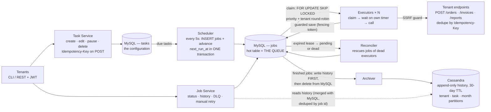

# Crobat — distributed job scheduler

**Cron as a service, in Go.** Tell Crobat to call a web address now, at a
set time, or on a recurring schedule. It makes the call, retries failures
with backoff, parks jobs that keep failing in a dead-letter queue for
review, and keeps a history of every run.

Most schedulers save a job in a database and then publish it to a
separate queue. If one of those two steps fails, they disagree forever.
**In Crobat there is no broker: a single MySQL table — `jobs` — is the
queue**, and the scheduler inserts job rows and advances the schedule in
one transaction. The schedule and the queue cannot disagree, because
they are the same write.


## Features

- **Three schedule kinds** — `now`, `at` (one-shot), and `cron` with
  IANA timezones (DST-aware, via robfig/cron).
- **4 priority levels** — critical, high, normal, low — with
  **fair sharing across tenants**: claim batches interleave tenants
  round-robin, so one tenant's burst can't starve the others.
- **Retries with exponential backoff + jitter**, per-task retry policy,
  and a **dead-letter queue** with manual retry.
- **At-least-once delivery, made safe** — every call carries
  `Idempotency-Key` (= job id), `X-Scheduled-At`, and `X-Attempt`
  headers; tenant endpoints dedupe by the key.
- **Lease + fencing token** — claims increment `jobs.attempt`; results
  are written with a guarded update
  (`WHERE status='running' AND worker_id=? AND attempt=?`), so a stale
  executor whose lease was taken over can never overwrite the new
  owner's result.
- **Encrypted secrets** — named headers are AES-256-GCM encrypted at
  rest and never returned by the APIs.
- **SSRF guard** — public IPs only, ports 80/443 only, no redirects,
  DNS-rebinding-safe dialing.
- **JWT tenant auth** on the REST APIs; tenants can only see their own
  tasks, jobs, and history.
- **History** — finished jobs are archived to Cassandra (append-only,
  30-day TTL); the Job Service merges hot + archived history, deduped
  by job id.
- **Idempotent task creation** — POSTs require an `Idempotency-Key`;
  replays return the original task.

## Architecture

Six Go services in hexagonal architecture (domain core, ports,
adapters). All state lives in MySQL (tasks + the jobs queue) and
Cassandra (history).



How a job flows:

1. **Task Service** stores the task (secrets encrypted) and computes
   `next_run_at`.
2. **Scheduler** (every 5 s) finds tasks due in the next 30 s and, in
   one transaction, inserts `pending` job rows and advances
   `next_run_at`.
3. **Executors** claim due jobs in batches
   (`SELECT ... FOR UPDATE SKIP LOCKED`), commit, wait on their own
   timers until the scheduled second, then call the endpoint through
   the SSRF guard.
4. A failed call retries per policy (backoff with jitter); exhausted
   jobs go to the **DLQ** (`status = dead`) for review and manual retry.
5. **Reconciler** rescues jobs whose executor died holding them
   (expired lease → back to `pending`, or `dead` if out of attempts).
6. **Archiver** moves finished jobs to Cassandra history — history
   write first, hot-row delete second.

Design deep-dives: [docs/design.md](docs/design.md) ·
[docs/load-testing.md](docs/load-testing.md)

## Quick start (Docker Compose)

```bash
docker compose up --build
```

This starts MySQL (schema auto-applied), Cassandra (schema applied by
the one-shot `cassandra-init` service), and all six services
(executors × 2). The Task Service listens on `:8081`, the Job Service
on `:8082`.

### Try it

Tenant APIs take a JWT with a `tenant_id` claim, signed with
`CROBAT_JWT_SECRET` (the compose file sets `dev-secret-change-me`).
Mint one with any JWT tool, then:

```bash
TOKEN=<your tenant jwt>

# Schedule a recurring call: weekdays at 9am New York time
curl -X POST localhost:8081/v1/tasks \
  -H "Authorization: Bearer $TOKEN" \
  -H "Idempotency-Key: daily-report-1" \
  -H "Content-Type: application/json" \
  -d '{
        "name": "daily report",
        "schedule": {"kind": "cron", "cron_expr": "0 9 * * 1-5", "timezone": "America/New_York"},
        "priority": "high",
        "request": {"method": "POST", "url": "https://example.com/reports",
                    "headers": {"Authorization": "Bearer s3cret"},
                    "secret_headers": ["Authorization"]},
        "max_attempts": 3, "backoff_base_seconds": 2, "backoff_max_seconds": 60
      }'

# Replaying the same POST with the same Idempotency-Key returns the
# same task (200) instead of creating a duplicate.

curl localhost:8082/v1/dlq -H "Authorization: Bearer $TOKEN"          # dead-letter queue
curl localhost:8082/v1/tasks/<task-id>/history -H "Authorization: Bearer $TOKEN"
curl -X POST localhost:8082/v1/jobs/<job-id>/retry -H "Authorization: Bearer $TOKEN"
```

### API summary

| Service | Route | Purpose |
| --- | --- | --- |
| Task | `POST /v1/tasks` | Create task (requires `Idempotency-Key` header) |
| Task | `GET /v1/tasks`, `GET /v1/tasks/{id}` | List / get tasks |
| Task | `POST /v1/tasks/{id}/pause` · `/resume` | Pause / resume scheduling |
| Task | `DELETE /v1/tasks/{id}` | Soft-delete a task |
| Job | `GET /v1/jobs/{id}`, `GET /v1/jobs?status=` | Job status |
| Job | `GET /v1/dlq` | Dead-letter queue |
| Job | `POST /v1/jobs/{id}/retry` | Manually retry a dead job |
| Job | `GET /v1/tasks/{id}/history` | Merged run history (MySQL + Cassandra) |

## Running without Docker

Every service also runs against in-memory stores
(`CROBAT_STORE=memory`), which is handy for poking at the APIs — state
is per-process, so run one service at a time:

```bash
go run ./cmd/task-service    # CROBAT_JWT_SECRET=dev CROBAT_SECRET_KEY=<base64 32-byte key>
```

For the real MySQL/Cassandra wiring, set `CROBAT_STORE=mysql`,
`CROBAT_MYSQL_DSN`, and `CROBAT_CASSANDRA_HOSTS` (see
`internal/platform` for all configuration).

## Tests

```bash
go build ./...   # or: make build
go vet ./...     # or: make vet
go test ./...    # or: make test
```

The unit suite (69 tests) runs entirely on the in-memory adapters —
same contracts, fencing, and fairness rules as the SQL adapters — and
covers: scheduler due-task logic, cron next-run including DST/timezone
cases, claim ordering + tenant fair-sharing, fencing-token rejection of
stale saves, reconciler lease expiry, retry backoff, the SSRF guard's
URL/IP cases, encryption round-trips, idempotent task creation, and
history merge/dedupe.

Integration tests that need a live MySQL live behind the `integration`
build tag (`make test-integration`, with `docker compose up` running).

## Load testing

`loadtest/k6-schedule-30k.js` schedules 30,000 jobs for the same
second. [docs/load-testing.md](docs/load-testing.md) is the write-up:
the two classic failure modes a burst like this exposes in
database-as-queue schedulers — a hidden throughput cap from serialized
claiming, and a claim deadlock that can execute a job twice — and the
mechanisms that address them (SKIP LOCKED batched claims, consistent
lock ordering, fencing tokens). It is design analysis, clearly
labelled: the k6 run needs Docker/k6 and has not been executed in the
environment this code was written in, so no measured numbers are
claimed.

## What's verified vs. what needs Docker

| Area | Status |
| --- | --- |
| All business logic (scheduler, executor, reconciler, archiver, task/job services) | ✅ Unit-tested against in-memory adapters (69 tests) |
| Cron/timezone math, retry backoff, SSRF guard, AES-GCM secrets, JWT | ✅ Unit-tested |
| REST APIs (auth, idempotency, tenant isolation) | ✅ Unit-tested via httptest |
| MySQL adapter SQL (SKIP LOCKED claim, scheduler transaction, guarded update) | ⚠️ Compiles + reviewed; needs a live MySQL 8 to execute — integration tests behind the `integration` tag |
| Cassandra history adapter | ⚠️ Compiles; needs a live Cassandra to execute |
| docker-compose deployment | ⚠️ Correct-by-construction; not executed in the build sandbox (no Docker) |
| k6 30,000-job burst | ⚠️ Script provided; not run (no Docker/k6 in the sandbox) |

## Project layout

```
cmd/                  the six service binaries
internal/domain       core types (Task, Job, schedules, retry policy)
internal/ports        interfaces the core depends on
internal/app          use cases: tasksvc, jobsvc, scheduler, executor,
                      reconciler, archiver, cronx, retry
internal/adapters     mysql, cassandra, memory, httpapi, httpcall,
                      ssrf, crypto, jwtauth
internal/platform     env config + adapter wiring
internal/e2e          full-pipeline test on the in-memory adapters
migrations/           MySQL schema + Cassandra schema
loadtest/             k6 burst script
docs/                 design notes + load-testing write-up
```

## License

MIT — see [LICENSE](LICENSE).
